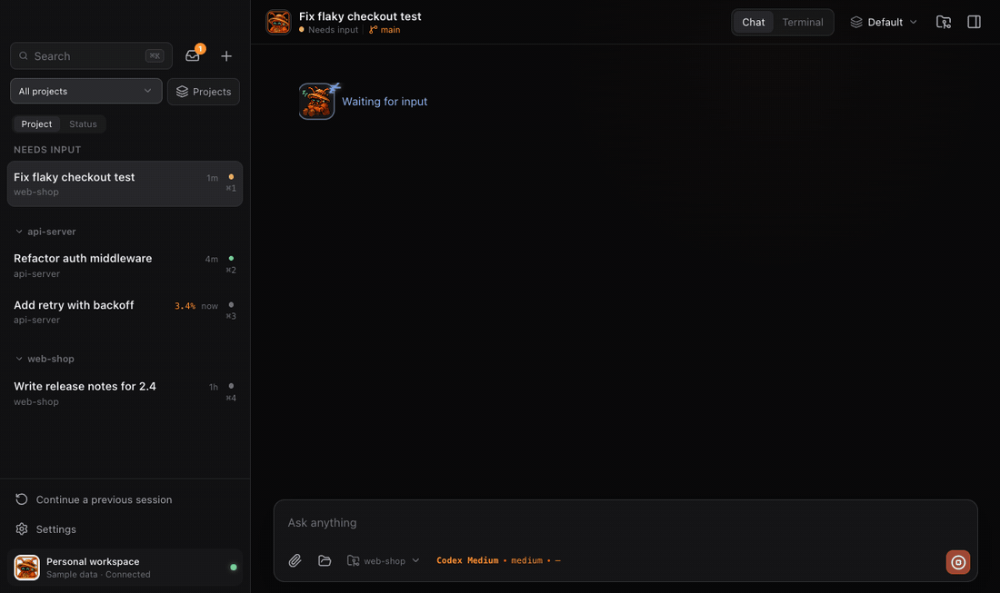
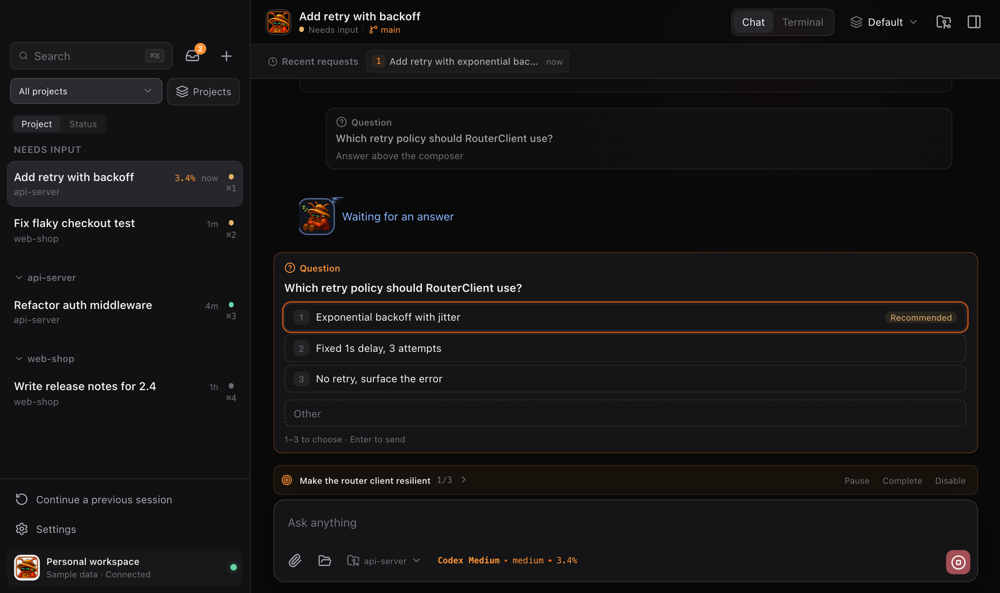
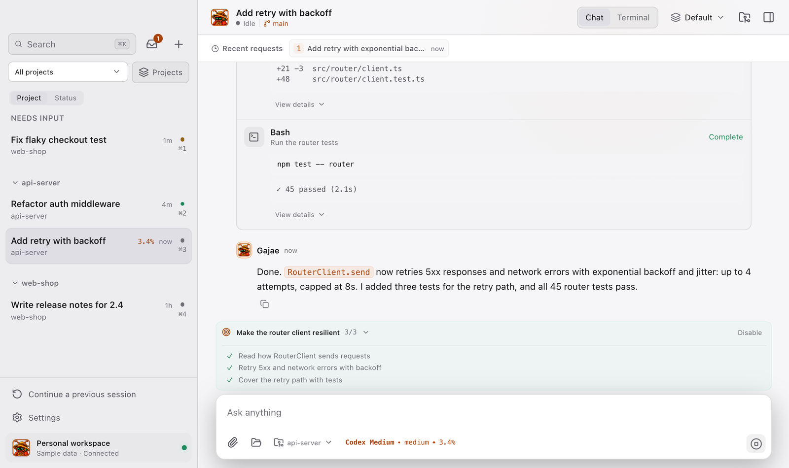

<p align="center">
  
</p>

<h1 align="center">Gajae</h1>

<p align="center">
  A desktop home for <a href="https://github.com/Yeachan-Heo/gajae-code">GJC</a> coding-agent sessions.<br>
  <sub>macOS · Apple silicon</sub>
</p>

<p align="center">
  
</p>

Gajae is an Electron app for running GJC sessions without living in a terminal.
It works on the same sessions as the `gjc` CLI, so a request started in the app
can be checked from the terminal and the other way round. Gajae never embeds the
agent: every live action goes through GJC's public `gjc sdk session` CLI, and
history comes from the session files GJC already writes.

## Demo

<p align="center">
  
</p>

The app running on its built-in sample data. A request reads code and runs the
tests, stops to ask which retry policy to use, then edits and finishes while the
goal above the composer ticks to 3/3. Full quality:
[demo.mp4](docs/media/demo.mp4), [promo.mp4](docs/media/gajae-promo.mp4).

## Features

- **Live conversations.** Replies stream in with reasoning and every read,
  command and edit as its own card. Queue or steer follow-up work while a turn
  runs, and stop it with Esc.
- **Questions and plan approvals.** When GJC asks (a deep interview, a ralplan
  approval), the choices appear as a card above the composer. Press 1–9 or type
  your own answer.
- **Goals.** An active goal stays pinned above the composer with its progress.
  Open it to see each task.
- **Projects sidebar.** Sessions group by repository, worktrees included.
  Anything waiting on you sits at the top. Switch to a by-status view any time.
- **CLI sessions.** Keep a terminal (your login shell, in a folder you pick) as a
  session next to your conversations. It keeps running while you look elsewhere.
- **Repository screen.** Branches, worktrees, issues, pull requests and CI for
  the project, through the `gh` CLI.
- **Remote access.** Pair a phone over Tailscale and follow or drive the same
  sessions from it.
- **Desktop integration.** Menu bar status, a Dock badge, notifications per event,
  a ⌃⌥Space quick input from any app, and keep-awake while a run is going.
- **First-run setup.** On a Mac without GJC, the app installs it, signs you in
  to a provider and opens the first conversation. No terminal needed.

<table>
  <tr>
    <td></td>
    <td></td>
  </tr>
</table>

## Install

Gajae needs an Apple-silicon Mac. The [`gh` CLI](https://cli.github.com), signed
in with `gh auth login`, is optional and powers the repository screen.

Run the installer in Terminal:

```bash
curl -fsSL https://raw.githubusercontent.com/Heyaaz/gajae-bot/main/install.sh | sh
```

With Node.js installed, `npx gajae` does the same. Either one downloads the
latest release, checks its SHA-256, puts `Gajae.app` in `/Applications` (or
`~/Applications` if that is not writable) and opens it. Run it again to update.

The app is not notarized yet. macOS blocks a copy downloaded in a browser, so
use the installer rather than the ZIP on the releases page.

On first launch, a Mac without GJC is walked through setup:

1. Gajae installs the GJC CLI from the public
   [`Yeachan-Heo/gajae-code`](https://github.com/Yeachan-Heo/gajae-code)
   releases, checked against their SHA-256, into `~/.local/bin/gjc`. That is
   where GJC's own installer puts it, so `gjc update` keeps working.
2. You sign in to one provider through GJC's own login. GJC stores the
   credential; Gajae does not.
3. Gajae applies GJC's recommended model profile and opens the first
   conversation.

A Mac that already runs GJC skips this. GJC `0.18.12` or newer is required.

## Quick start

1. Press **⌘T** (or **+**) and pick a folder. Settings decides whether a new
   session is an app conversation or a CLI session.
2. Type a request and press **Enter**. Drop files or images in to send them as
   local paths.
3. While it runs, keep typing to queue the next request, or press **Esc** to
   stop.
4. Answer question cards with **1–9**, then **Enter**.

| Key | Action |
| --- | --- |
| `⌘T` | New session |
| `⌘1`–`⌘9` | Select a session in sidebar order |
| `⌘K` | Search sessions and messages |
| `⌥⌘U` | Inbox |
| `⌃⌥Space` | Quick input from any app |
| `Shift+Tab` | Cycle effort |
| `Esc` | Stop the current run |

## Documentation

- [Using Gajae](docs/usage.md): the full guide, from running turns and slash
  commands to deleting sessions and parallel runs.
- [Remote access](docs/remote-access.md): pairing a phone or a second machine.
- [Developing Gajae](docs/development.md): running from source, packaging,
  and GJC compatibility notes.
- [Feature map](docs/features/README.md): scripted checks for each feature.

## Build from source

Node.js 24 or newer:

```bash
npm install
npm test
npm run dev:desktop    # Electron + Vite
npm run package:mac    # local, ad-hoc signed app in release/
```

See [Developing Gajae](docs/development.md) for public release signing and
the project layout.

## License

Gajae source code is available under the [MIT License](LICENSE). A public binary
release is produced only after the maintainer separately confirms redistribution
rights for the bundled artwork.
